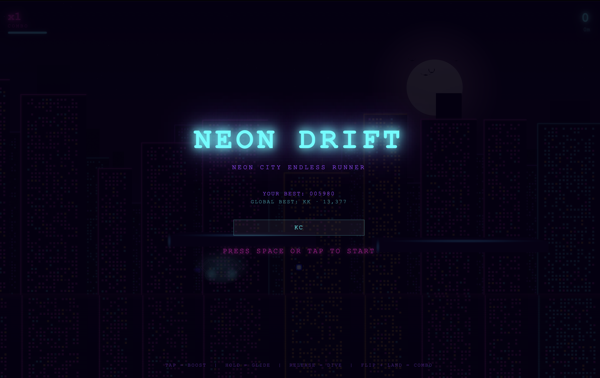

# NEON DRIFT

A neon-city endless runner. Boost, glide, dive, flip, and chain landings for combos while a procedurally generated cyberpunk skyline scrolls past.

### ▶ [Play it live](https://erscheinung.github.io/Neon-Drift-2D/)

[](https://erscheinung.github.io/Neon-Drift-2D/)

## Controls

| Input | Action |
| --- | --- |
| Tap / Space | Boost |
| Hold | Glide (reduced gravity) |
| Release | Dive (harder fall) |
| Flip + land | Combo multiplier |

Tap or press Space on the start screen to play. Enter a name/initials once and it persists locally.

## Features

- Procedurally generated, parallax neon skyline with lit window grids, water reflection, drifting sky, crows, and wind gusts.
- Momentum platforming: boost / glide / dive with a fuel meter and coyote-time grace.
- Flip-and-land combo scoring with escalating multipliers.
- Collectible data shards, patrol/tracking drones, and blink/sweep laser hazards.
- Distance-driven zone color cycling.
- Local personal best; the public branch leaves the global leaderboard offline until a server-side API is configured.

## Tech

- [three.js](https://threejs.org/) for the WebGL foreground, rendered over a transparent canvas.
- A separate 2D-canvas engine draws the procedural skyline behind it.
- Plain browser JavaScript and ES modules; no build step.

## Branches

- `main` — complete static implementation for public hosting, with no leaderboard credentials.
- `airtable-integration` — optional server-side Airtable adapter. It contains no real credentials; configure secrets in the hosting provider instead.

## Security rule

Never put an Airtable personal access token, a Supabase service-role key, or another private credential in `highscore.js`, HTML, browser JavaScript, or any other file delivered to users. Browser code is public by design. If a credential has ever been committed, revoke it and create a replacement before deploying.

The browser adapter uses this API contract:

```text
GET  /api/leaderboard?limit=10&sort=score-desc
     -> { "records": [{ "name": "Pilot", "score": 123 }] }

POST /api/leaderboard
     body: { "name": "Pilot", "score": 123 }
     -> any 2xx response on success
```

## Optional Airtable leaderboard

The `airtable-integration` branch includes a serverless `api/leaderboard.js` route. To use it:

1. Create a table with `Name`, `Score`, and `Date` fields.
2. Create a restricted Airtable token with only the required record permissions and access to only this base.
3. Add these values as server-side deployment environment variables—never commit them:

   ```text
   AIRTABLE_PAT
   AIRTABLE_BASE_ID
   AIRTABLE_TABLE_ID
   ```

4. Deploy the branch and confirm that `/api/leaderboard` is same-origin with the game.
5. Add rate limiting, input validation, and abuse controls before treating scores as authoritative. The sample route validates basic input but does not prevent score spoofing.

If the project is hosted on another platform, keep the same API contract and adapt the route to that provider's serverless-function format.

## Optional Supabase leaderboard

Supabase is an alternative backend. A safe setup is:

1. Create a `scores` table with `name text`, `score integer`, and `created_at timestamptz`.
2. Enable Row Level Security and expose only the minimum read/insert policies needed by the server route.
3. Put `SUPABASE_URL` and `SUPABASE_SERVICE_ROLE_KEY` in server-side environment variables. The service-role key must never be sent to the browser.
4. Implement the same `GET` and `POST` API contract above using a serverless function or Supabase Edge Function.
5. Validate name length and score range, rate-limit submissions, and consider moderation or signed scores if leaderboard integrity matters.

The public Supabase anon key is not a substitute for Row Level Security. Do not use the service-role key in `highscore.js` or ship it in frontend configuration.

## GitHub Pages

This repository is fully static, so GitHub Pages can host it directly. The workflow in `.github/workflows/pages.yml` deploys `main` automatically after each push. No npm build or deploy command is required.

## Development

Serve the folder over HTTP so ES modules load correctly; do not open `index.html` directly with `file://`:

```bash
python3 -m http.server 8177
# then open http://localhost:8177
```
